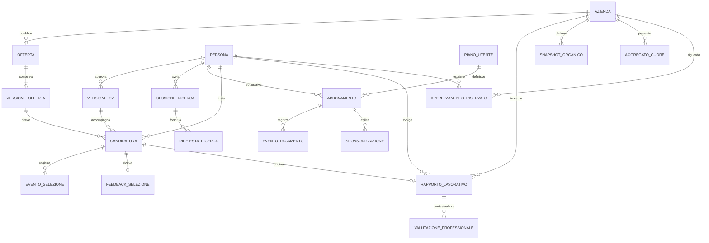

# Modello dei dati e flussi

Versione 1.2 — 23 ottobre 2026. Modello logico proposto per guidare l'implementazione futura; include ricerca conversazionale, abbonamento e sponsorizzazione, senza imporre uno stack o fornitori.

## 1. Relazioni fondamentali

APPREZZAMENTO_RISERVATO è una relazione di controllo interna, mai restituita alle API aziendali o pubbliche. Il diagramma non rappresenta tutti i dati personali come pubblici. Il feedback ha una risposta corrente e può mantenere revisioni storiche controllate.

Per il prototipo ogni rapporto nasce da una candidatura. In futuro un rapporto nato fuori piattaforma richiede un flusso dedicato di verifica: non si aggiunge un'assunzione fittizia per abilitare un like.

## 2. Entità e dati essenziali

| Entità | Dati e regole |
|---|---|
| Account | Identità di accesso, ruoli e autorizzazioni; separati dal contenuto pubblico del profilo |
| Persona | Profilo professionale, preferenze, impostazioni di visibilità; stato candidato/dipendente derivato dai rapporti |
| Racconto e sessione AI CV | Input dell'utente, chiarimenti, estrazioni e conferme per il CV; accesso ristretto e conservazione da definire |
| Sessione di ricerca conversazionale | Dialogo e ricerca temporanea della persona, distinta dal CV; salvataggio e conservazione secondo scelta esplicita e politica definita |
| Richiesta di ricerca | Sintesi, criteri validati, operatori AND/OR, unità, vincoli/preferenze, informazioni mancanti, provenienza e versione; sincronizzata con i filtri manuali |
| Piano utente | Piano facoltativo di sponsorizzazione: 20 euro al mese, valuta EUR, versione del prezzo e condizioni |
| Abbonamento | Persona, piano, periodo coperto, stato, rinnovo e riferimenti del fornitore; nessun dato completo di carta |
| Evento pagamento | Identificativo univoco, importo/valuta, tipo, periodo, esito verificato e riferimenti per evitare duplicazioni |
| Sponsorizzazione | Beneficio collegato al periodo valido, stato visibilità e perimetro autorizzato; nessuna modifica a competenze o rating |
| Versione CV | Contenuto approvato, data, evidenze collegate, autorizzazioni e revisioni |
| Competenza | Identificativo, descrizione, livello atteso/dichiarato, provenienza e stato dell'evidenza |
| Evidenza | Documento/progetto/prova, autore e metodo della verifica; accesso minimo e nessuna verifica fittizia |
| Azienda | Identità, perimetro, sedi, settore, stato di verifica |
| Referente aziendale | Appartenenza e permessi sulla specifica azienda; non può leggere altre organizzazioni |
| Snapshot organico | Numero, data di riferimento, perimetro, fonte e verifica; storico non sovrascrivibile senza traccia |
| Offerta/versione | Condizioni, requisiti, percorso di crescita e metadati di pubblicazione |
| Tappa di crescita | Ruolo, responsabilità, stipendio, benefit, requisiti e condizioni/tempi |
| Candidatura | Persona, offerta/versione, CV/versione, stato e date; una candidatura attiva per persona/offerta nella proposta iniziale |
| Evento selezione | Messaggio, invito, meeting, aggiornamento, proposta, esito; autore, data e collegamento |
| Feedback selezione | Dieci risposte S01–S10, contesto ricavato dalla candidatura, testo facoltativo integrato in S10, visibilità dichiarata e versione del questionario |
| Rapporto lavorativo | Persona, azienda, data inizio/fine, verifica, versione delle condizioni accettate e variazioni |
| Apprezzamento riservato | Unicità persona/azienda, rapporto qualificante, eleggibilità, attivo/ritirato; collegamenti accessibili solo al servizio autorizzato |
| Aggregato cuore | L, N, E interni; valore pubblicabile, copertura pubblicabile, data, regola di aggregazione e stato privacy |
| Valutazione professionale | Autore autorizzato, rapporto, periodo, cinque voci D01–D05 su quattro aree, contesto, replica, versione del questionario e revisioni |
| Fonte salariale | Provenienza, licenza/condizioni d'uso, territorio, ruolo/livello, periodo e unità |
| Benchmark salariale | Dati di input, fascia, metodo/versione, copertura e fonti; stato disponibile/insufficiente |
| Analisi gap | Versioni di CV e requisiti, esiti per competenza, dati mancanti, metodo e data |
| Risorsa formativa | Titolo, competenze, autore/ente, link, durata/costo/modalità, prerequisiti e stato verifica |
| Segnalazione | Oggetto, motivo, accessi autorizzati, stato, replica e decisioni motivate |
| Consenso/autorizzazione | Scopo, ambito e versione dell'informativa o scelta; non si presume che un'unica spunta abiliti ogni trattamento |
| Registro operazioni | Eventi necessari a ricostruire modifiche, pubblicazioni e accessi, senza duplicare indiscriminatamente dati privati |

## 3. Stati principali

### Offerta

Bozza → verifica di completezza → anteprima → pubblicata → sospesa/chiusa/annullata. Una modifica dopo la pubblicazione genera una nuova versione. Le candidature già inviate conservano quella originaria; le nuove condizioni vengono comunicate e, quando necessario, confermate.

### CV

Racconto iniziale → estrazione AI → chiarimenti → bozza → revisione della persona → approvato → condiviso. Un errore AI riporta a chiarimenti o revisione. Nessuna bozza non approvata viene automaticamente distribuita alle aziende.

### Ricerca conversazionale

Messaggio informale → estrazione dei criteri → validazione → eventuale chiarimento → richiesta e filtri visibili → esecuzione sul catalogo → risultati → raffinamento tramite chat o controlli manuali. Solo le ambiguità che cambiano il significato richiedono chiarimenti; una richiesta chiara può essere eseguita direttamente. L'assenza di risultati non autorizza modifiche autonome dei vincoli. La ricerca viene salvata nelle preferenze persistenti solo su scelta della persona.

### Candidatura

Inviata → presa in carico → colloquio/prova → proposta → accettata → ingresso confermato.

Da stati pertinenti: non selezionata, ritirata, proposta rifiutata, ricerca annullata. Il fatto di non ricevere una risposta non si trasforma in un rifiuto automatico. «Proposta accettata» non equivale a «rapporto iniziato».

Messaggi e appuntamenti possono ripetersi. Uno stato sintetico non elimina la cronologia. Il conteggio dei candidati usa persone uniche; inviare più messaggi o riprogrammare colloqui non lo incrementa.

### Rapporto

In attesa di conferma → attivo verificato → eleggibile a sei mesi → concluso. Una contestazione sulla data viene gestita prima di abilitare contributi pubblicabili. Modifiche del ruolo o delle condizioni sono eventi del rapporto e non riscrivono la data iniziale senza motivazione.

La proposta iniziale misura sei mesi sullo stesso rapporto continuativo. Rinnovi senza interruzione e riassunzioni richiedono regole esplicite: non si sommano periodi arbitrariamente e non si azzera l'anzianità per una semplice riassegnazione alla stessa azienda.

### Abbonamento e sponsorizzazione

Piano selezionato → pagamento in attesa → conferma verificata → periodo attivo → rinnovo o scadenza. Disattivare il rinnovo e sospendere la visibilità sono azioni distinte. Lo stato del pagamento non deriva dalla sola interfaccia del browser. La sponsorizzazione è mostrabile soltanto se il beneficio è valido, il profilo è autorizzato e rispetta i criteri della ricerca; le regole di scadenza, pagamento fallito e rimborsi sono da consolidare prima della vendita reale.

## 4. Permessi e visibilità

| Informazione/azione | Persona interessata | Azienda pertinente | Pubblico |
|---|---|---|---|
| Racconto libero e bozza CV | Legge/modifica | Nessun accesso predefinito | Nessuno |
| Conversazione e richiesta di ricerca | Proprie, modificabili; salva espressamente le preferenze | Nessun accesso predefinito | Nessuno |
| Abbonamento e pagamenti | Propri, con gestione rinnovo e visibilità | Nessun accesso allo storico economico | Nessuno |
| Badge sponsorizzato | Vede il proprio stato | Vede il badge sul profilo autorizzato nei risultati pertinenti | Nessun nuovo accesso al CV derivante dal pagamento |
| CV approvato | Controlla la condivisione | Solo nel perimetro autorizzato | Solo eventuali parti rese pubbliche dalla persona |
| Preferenze riservate | Legge/modifica | Solo informazioni professionali autorizzate necessarie all'incontro | Nessuno |
| Offerta pubblicata e crescita | Legge | Gestisce con autorizzazione | Legge |
| Messaggi e meeting | Solo proprie candidature | Solo proprie candidature e referenti autorizzati | Nessuno |
| Feedback individuale di selezione | Proprio | Secondo visibilità proposta da confermare | Nessuno |
| Aggregati selezione | Legge se pubblicabili | Legge | Solo dati sufficientemente protetti |
| Organico | Legge dato pubblicato | Aggiorna con fonte, soggetto a verifica | Numero/perimetro/data/stato verifica |
| Scelta individuale del like | Propria | Mai accesso | Mai accesso |
| Cuore aggregato | Legge se pubblicabile | Stesso aggregato pubblicabile | Legge se pubblicabile |
| Valutazione aziendale sul dipendente | Legge propria e replica | Autrice e referenti autorizzati | Nessuno nella proposta iniziale |
| Gap individuale | Proprio | Solo su profilo/confronto autorizzato | Nessuno |
| Stima salariale e fonti | Legge | Legge | Secondo visibilità dell'offerta |

Le autorizzazioni sono applicate sul server e sul singolo oggetto, non soltanto nascondendo pulsanti. La gestione interna ha permessi limitati allo scopo: il supporto ordinario non riceve automaticamente il collegamento tra votanti e aziende.

## 5. Funzioni AI come servizi separati

| Servizio | Input autorizzati | Output | Controllo |
|---|---|---|---|
| Costruzione CV | Racconto e chiarimenti della persona | Bozza strutturata, domande, evidenze collegate | Approvazione della persona |
| Ricerca conversazionale | Messaggi della persona, filtri attivi e schema dei criteri consentiti | Richiesta strutturata, chiarimenti e spiegazione dei filtri | Validazione server, ricerca deterministica, filtri modificabili; nessuna candidatura automatica |
| Definizione offerta | Bisogni e risposte dell'azienda | Bozza mansioni/requisiti/crescita | Approvazione dell'azienda |
| Compatibilità | Versioni approvate di requisiti e profilo | Spiegazioni e aspetti da approfondire | Scelta umana, filtri visibili |
| Benchmark salario | Dati salariali curati e parametri confrontabili | Intervallo/metodo/copertura e spiegazione | Fonte obbligatoria, nessun dato inventato |
| Gap e formazione | Requisiti, evidenze e catalogo verificato | Gap per requisito e risorse pertinenti | Sconosciuto separato da mancante |
| Sintesi selezione | Feedback nel perimetro autorizzato e sufficientemente aggregati | Temi ricorrenti e suggerimenti | Nessuna identificazione dei votanti o giudizio fattuale inventato |

Il cuore è calcolato da regole deterministiche sui dati autorizzati. Non serve un modello linguistico per riempirlo o attribuire like. La valutazione professionale è compilata dal referente umano, non dedotta dall'AI.

Anche la sponsorizzazione segue regole applicative distinte dall'AI: si applicano prima autorizzazioni e criteri aziendali, poi gli spazi promozionali etichettati. Lo stato di pagamento non entra nella stima delle competenze, nel gap, nel cuore o nelle valutazioni. L'AI non attribuisce maggiore capacità professionale a un profilo pagante.

I contenuti di CV, messaggi, documenti e offerte sono dati non attendibili come istruzioni: eventuali frasi che chiedono di cambiare regole o rivelare dati non devono essere eseguite dal modello. I servizi ricevono solo le informazioni necessarie e non possono interrogare liberamente dati di altre persone o aziende.

La ricerca conversazionale restituisce criteri entro uno schema consentito; il modello non esegue query arbitrarie. Richieste e conversazioni di ricerca non aggiornano automaticamente CV o preferenze permanenti. Gli output dei questionari conservano la versione: non si mescolano automaticamente i precedenti 21/11 elementi con i nuovi 10/5.

La configurazione del fornitore AI resta separata da questi servizi. Gemini Pro è l'opzione da valutare successivamente indicata dall'utente; modello preciso, accessi, quote, costi e uso della chiave saranno definiti in quella fase. La futura chiave sarà riservata al server e non presente nel repository o nel browser. Il flusso dettagliato è in [Ricerca conversazionale AI](RICERCA_CONVERSAZIONALE_AI.md).

## 6. Specifica proposta dell'indice gap

Il dettaglio per competenza è l'output principale. Se si aggiunge una sintesi numerica, una formula candidata da verificare è:

- peso w_i assegnato al requisito e confermato dall'azienda;
- avanzamento a_i compreso tra 0 e 1 soltanto quando il livello è effettivamente valutabile;
- U insieme dei requisiti con informazioni insufficienti;
- gap stimato sui requisiti valutabili = `100 × somma(w_i × (1 − a_i)) / somma(w_i)` sugli i non in U;
- copertura = `100 × somma(w_i degli i non in U) / somma(w_i di tutti i requisiti)`.

La scelta dei livelli a_i e dei pesi non è ancora approvata. Se nessun requisito è valutabile, il gap è non disponibile. Una copertura bassa impedisce di presentare il numero come quadro completo. Se mancano abilitazioni necessarie, il dettaglio le evidenzia senza compensarle con una media elevata sulle altre capacità.

La stessa versione di requisiti e profilo deve produrre risultati riproducibili nel metodo documentato; gli aggiornamenti sono tracciati. Questo indice non pretende di misurare la capacità globale della persona o la sua probabilità certa di assunzione.

## 7. Operazioni e controlli trasversali

- Unicità candidature, like e contributi secondo le regole applicabili.
- Conteggi aziendali pubblicati solo attraverso aggregati autorizzati.
- Trigger temporali idempotenti: un richiamo o un job ripetuto non crea nuovi voti o questionari duplicati.
- Eventi di pagamento verificati e idempotenti; un evento ripetuto non duplica abbonamenti o periodi di sponsorizzazione.
- Scadenza del beneficio e permessi di visibilità controllati sul server anche per gli spazi sponsorizzati.
- Date normalizzate, presentazione coerente con Europe/Rome, scadenze in mesi di calendario.
- Separazione dati demo/produzione; nessun messaggio reale da simulazioni.
- Modifiche e revoche propagate agli aggregati senza pubblicare variazioni individuali.
- Accesso, rettifica, esportazione e cancellazione progettati con tempi di conservazione espliciti; le esigenze di integrità non autorizzano conservazione illimitata.
- Le condizioni accettate e le promesse restano ricostruibili anche quando l'offerta pubblica cambia.

## 8. Confine prima del rilascio reale

La modalità di verifica dei rapporti e dell'organico, la politica di anonimato nelle microimprese, i diritti sulle valutazioni, i tempi di conservazione e la classificazione dei sistemi AI occupazionali richiedono verifica specifica prima della produzione. Avere una decisione umana finale non elimina automaticamente gli obblighi collegati al matching AI. Le fonti istituzionali sono nel registro decisioni.
